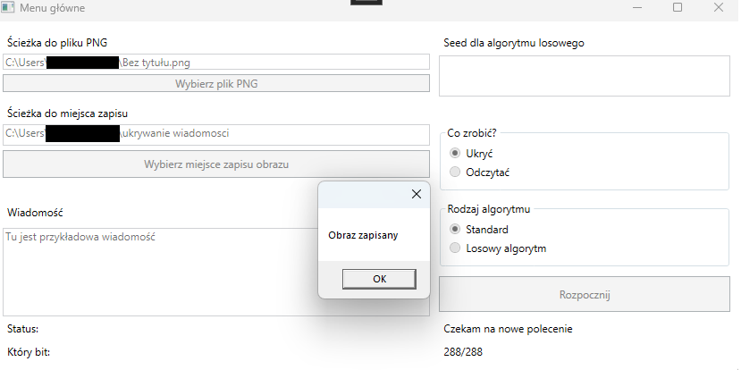
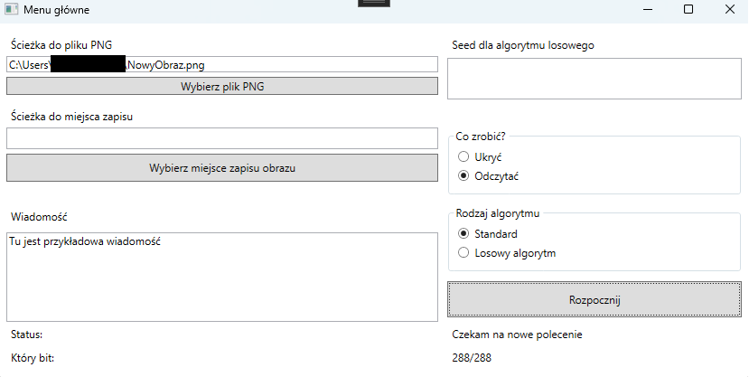
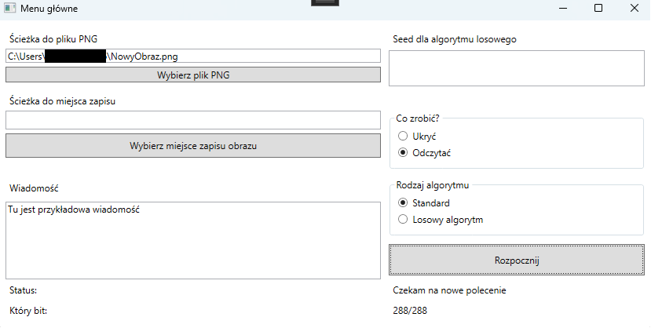

# UkrywanieWiadomosci

Aplikacja desktopowa (WPF, .NET 10) do ukrywania wiadomości tekstowej w obrazie PNG i jej odczytu. Wiadomość jest zapisywana w najmłodszych bitach pikseli (metoda LSB, steganografia). Dostępne są dwa tryby: standardowy i losowy z kluczem tekstowym.

## Funkcje

- Ukrywanie tekstu (UTF-8, polskie znaki) w obrazie PNG i zapis wyniku jako `NowyObraz.png` w wybranym folderze.
- Odczyt wiadomości z obrazu przygotowanego tym programem.
- Tryb standardowy: kolejne bity w najmłodszym bicie kanału czerwonego kolejnych pikseli.
- Tryb losowy: położenie bitów (piksel i kanał R/G/B) wyznaczane z klucza tekstowego (seed).
- Pasek statusu i licznik postępu w trakcie pracy; okno pozostaje responsywne.
- Walidacja danych przed rozpoczęciem pracy i czytelne komunikaty o błędach.

## Zrzuty ekranu

**Ukrywanie, tryb standardowy**

**Ukrywanie, tryb losowy (klucz „przykładowa")**

**Odczyt, tryb standardowy**

**Odczyt, tryb losowy**

## Jak to działa

Pierwsze 32 bity (najmłodszy bit kanału R pikseli o x = 0…31 w pierwszym wierszu) zawierają liczbę bitów wiadomości. Dalej:

- **Standard:** bity wiadomości idą kolejno w najmłodszym bicie kanału R, od 33. piksela.
- **Losowy:** `System.Random` zainicjowany ziarnem z SHA-256 klucza wybiera pozycje (x od 32, dowolne y, bez powtórzeń) i kanał (R, G lub B) dla każdego bitu. Do odczytu potrzebny jest ten sam klucz.

Przy odczycie program interpretuje nagłówek jako liczbę i odrzuca obraz, jeśli jest ujemna albo większa niż pojemność obrazu (komunikat „Obrazek ma źle zakodowaną ilość bitów do odczytu").

## Architektura

- `Prezentacja` – okno WPF, dialogi plików, zarządzanie kontrolkami, budowa rekordu danych z formularza.
- `Aplikacja` – interfejsy i serwisy (weryfikacja danych, obsługa plików, kontrola ukrywania i odczytu), modele (`DanePoczatkowe`, `DaneRaportowaniaPostepu`). Bez odwołań do WPF.
- `Domena` – stałe (nazwa pliku wynikowego, komunikaty statusu).
- Zależności wstrzykiwane przez `Microsoft.Extensions.DependencyInjection` (`App.xaml.cs`).
- Przetwarzanie w tle: `async/await` + `Task.Run`, postęp przez `IProgress<string>`.
- Błędy: własny wyjątek `BladOperacjiException` z wyjątkiem źródłowym.

## Wymagania i uruchomienie

- Windows, .NET 10 SDK.
- Otwórz `UkrywanieWiadomosci.slnx` w środowisku z obsługą .NET 10 albo uruchom projekt poleceniem `dotnet run`.

## Ograniczenia

- Obsługiwany jest wyłącznie format PNG (bezstratny); zapis w JPEG zniszczyłby ukryte bity.
- Tryb losowy nie jest zabezpieczeniem kryptograficznym: `System.Random`, 32-bitowe ziarno z SHA-256, jawny nagłówek.
- Nagłówek nie ma sygnatury ani sumy kontrolnej. Odczyt w złym trybie lub ze złym kluczem zwykle nie zgłasza błędu i zwraca nieczytelny tekst. Obraz bez wiadomości może przejść kontrolę nagłówka (np. obraz jednolity o parzystej wartości kanału R daje nagłówek 0, czyli pustą wiadomość).
- Dostęp do pikseli przez `GetPixel`/`SetPixel` jest prosty, ale wolniejszy przy bardzo dużych obrazach.
- Brak testów automatycznych.

## Możliwe dalsze kroki

- Sygnatura i suma kontrolna w nagłówku.
- Testy jednostkowe warstwy Aplikacja.
- Szybszy dostęp do pikseli (`LockBits`).
